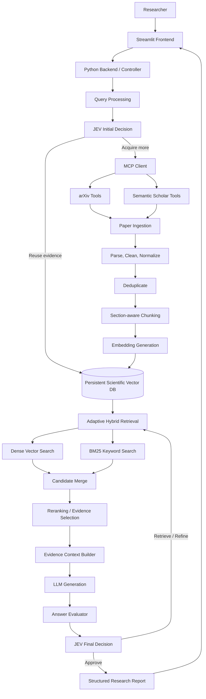

# MCP-Based Agentic Research Assistant for Scientific Literature Analysis

> **Document type:** Complete project architecture, implementation, and execution blueprint  
> **UI:** Streamlit  
> **Application/backend:** Python  
> **Core workflow:** JEV decision-making → MCP literature acquisition → persistent scientific memory → adaptive Hybrid RAG → LLM synthesis → evaluation → second JEV decision

---

## 1. Project overview

Scientific publications are growing rapidly. Researchers spend substantial time discovering papers, comparing methodologies, reviewing findings, tracing sources, and identifying possible research gaps. A conventional chatbot or basic Retrieval-Augmented Generation (RAG) application may search a fixed corpus or repeatedly retrieve and process similar papers across sessions.

This project proposes an **MCP-Based Agentic Research Assistant** that maintains persistent scientific literature memory and makes evidence-driven decisions about when additional literature is needed. The user submits a research question through a Streamlit interface. An initial JEV decision stage determines whether existing evidence in the persistent database should be reused, supplemented, or expanded. When new literature is required, the system invokes MCP-connected tools for sources such as arXiv and Semantic Scholar. Retrieved paper records and available full text are normalized, deduplicated, parsed, chunked, embedded, and stored for future reuse.

At query time, Hybrid RAG combines dense vector retrieval and keyword retrieval (BM25), merges candidates, reranks them, and builds a citation-aware context. An LLM generates a structured response from that evidence. An evaluator checks relevance, evidence coverage, citation support, and factual consistency. A second JEV decision stage then approves the answer or requests another bounded retrieval/refinement cycle.

Expected outputs include literature summaries, paper and methodology comparisons, evidence-supported answers, research trends, and potential research gaps.

**Important JEV note:** The exact mathematical definition, inputs, outputs, thresholds, and decision rules of JEV must come from the specific JEV paper/specification selected by the project. Until that reference is fixed, this README describes a replaceable JEV decision-engine interface. It does not invent JEV equations or claim unverified properties.

## 2. Problem statement

Researchers face difficulty keeping up with the increasing volume of scientific publications. Existing search and question-answering workflows can repeat external searches, PDF processing, and indexing. Basic RAG systems may retrieve a fixed number of chunks without deciding whether the current evidence is adequate or whether more literature should be acquired.

**Research problem:** How can an AI research assistant reuse previously indexed scientific literature, determine when additional evidence is needed, acquire new papers through MCP, and produce evidence-grounded research outputs while reducing redundant retrieval and processing?

## 3. Aim and objectives

**Aim:** Design and develop an agentic scientific research assistant combining persistent literature memory, JEV-based decision-making, MCP-based paper acquisition, adaptive Hybrid RAG, LLM synthesis, and iterative evidence evaluation.

**Objectives**
1. Accept natural-language scientific questions through Streamlit.
2. Maintain persistent storage of papers, chunks, embeddings, and metadata.
3. Use JEV to decide whether stored evidence is adequate.
4. Invoke MCP-connected literature sources when more papers are required.
5. Parse, normalize, deduplicate, chunk, embed, and persist new papers.
6. Retrieve evidence using dense semantic search and BM25 keyword search.
7. Merge and rerank candidates before constructing LLM context.
8. Generate structured answers with traceable citations.
9. Evaluate relevance, evidence coverage, citation support, and consistency.
10. Use JEV again to approve or initiate another retrieval/refinement cycle.
11. Record decisions, retrieval traces, errors, and evaluation results.
12. Compare quality, latency, retrieval volume, duplicate processing, and cost against baselines.

## 4. Scope and boundaries

### Included
- Streamlit dashboard and research interface.
- Python backend and modular service layer.
- JEV decision-engine integration.
- MCP tool integration for scholarly sources.
- Paper metadata collection and document ingestion.
- Persistent vector database and metadata storage.
- Hybrid retrieval, candidate merging, reranking, and evidence selection.
- LLM-based response generation and answer evaluation.
- Iterative refinement with a maximum cycle limit.
- Report display/export, logging, configuration, and tests.

### Not automatically included
Knowledge graphs, formal systematic-review compliance, guaranteed access to paywalled PDFs, guaranteed discovery of all relevant papers, production-grade multi-user authentication, and cloud deployment are not assumed to exist unless separately implemented. Research-gap suggestions require human verification.

## 5. High-level architecture



| Component | Responsibility |
|---|---|
| Streamlit | Collects queries and displays decisions, evidence, reports, and status. |
| Python backend | Coordinates services and controls workflow. |
| Query processor | Validates and normalizes query and filters. |
| Initial JEV stage | Decides whether stored evidence should be reused or supplemented. |
| MCP client | Discovers and invokes connected tools. |
| Source adapters | Search supported scholarly services. |
| Ingestion pipeline | Parses and prepares papers for persistence. |
| Vector database | Stores searchable chunk vectors and metadata. |
| Hybrid retriever | Combines dense and keyword retrieval. |
| Reranker | Reorders candidate chunks by query relevance. |
| Context builder | Selects evidence and preserves citation provenance. |
| LLM | Synthesizes an answer from supplied evidence. |
| Evaluator | Reports answer and evidence deficiencies. |
| Final JEV stage | Approves or requests bounded refinement. |
| Report builder | Formats the final result and references. |

## 6. Complete end-to-end workflow

### Stage 1 — User query
The researcher enters a question, for example: “Compare recent adaptive RAG approaches, summarize their retrieval strategies, and identify potential research gaps.” Optional filters may include publication years, source, domain, keywords, and analysis type (literature review, paper comparison, methodology analysis, trend analysis, or research-gap exploration).

The query processor validates the input, retains the original question, normalizes whitespace, and creates a structured query object.

### Stage 2 — Initial JEV decision
The backend passes the query and relevant memory/evidence state to the JEV adapter. Based on the selected JEV specification, the decision stage determines whether current scientific memory is sufficient or additional evidence is needed.

Possible **application-level action labels** are `REUSE_EXISTING`, `ACQUIRE_MORE`, `REUSE_AND_ACQUIRE`, and `INSUFFICIENT_OR_ERROR`. These are adapter labels, not asserted native JEV outputs. Map the real JEV output to these actions only after its reference and schema are known.

Record the session ID, decision, explanation/trace actually returned, evidence references considered, timestamp, and model/version. Do not display a JEV confidence or sufficiency score unless the implementation defines and produces a validated score.

### Stage 3 — MCP literature acquisition
If more literature is needed, the MCP client connects to configured servers, discovers available tools and schemas, validates arguments, invokes search tools, handles pagination/rate limits, and normalizes results.

Potential sources:
- **arXiv:** preprints and metadata in supported subject areas.
- **Semantic Scholar:** scholarly metadata and other API-supported information.

MCP is the tool-integration protocol; it is not the search-ranking algorithm, embedding model, vector database, or RAG pipeline. Metadata availability does not guarantee full-text/PDF availability. The application must respect source terms, API limits, copyright, and access restrictions.

### Stage 4 — Paper ingestion and preprocessing

**4.1 Metadata normalization:** Normalize title, authors, abstract, year, venue (if available), DOI, arXiv ID, Semantic Scholar ID, source, URL, PDF availability, and retrieval timestamp. Keep unknown fields null; never fabricate metadata.

**4.2 Text extraction:** For accessible PDFs, use a parser such as PyMuPDF. Preserve page information and section headings where possible. Multi-column layouts, equations, tables, headers, footers, and scanned PDFs can cause extraction errors. The first version may support text-based PDFs and flag unsupported/scanned documents; OCR can be a later extension.

**4.3 Cleaning:** Normalize whitespace and line breaks, remove repeated headers/footers only when confidently identified, preserve meaningful headings, equations, and citations, and retain raw extracted text for traceability.

**4.4 Deduplication:** Prefer DOI, arXiv ID, and Semantic Scholar ID. Use normalized title + author/year as a fallback and content hashes for exact duplicates. Merge source metadata into one canonical record. Do not merge preprint and published versions based only on similar titles; retain version relationships where appropriate.

**4.5 Chunking:** Prefer section-aware chunking. Chunk size and overlap must be configurable and experimentally tuned. Each chunk should retain `paper_id`, `chunk_id`, title, authors/year, section, page range (if available), DOI/arXiv ID, source, paper URL, and chunk text.

**4.6 Embeddings:** Generate vectors using one selected embedding model. Use the same compatible model and preprocessing for stored chunks and query embeddings. A possible starting candidate is `BAAI/bge-small-en-v1.5`; validate it on the project corpus before fixing it.

### Stage 5 — Persistent scientific memory
The database is the long-term scientific memory and must survive application restarts. A practical local design is ChromaDB for vector storage plus SQLite for canonical paper metadata and workflow records. PostgreSQL can replace SQLite for a larger/shared deployment. Original PDFs, where permitted, can be stored in a controlled local or object-storage directory.

Responsibilities:
- Vector DB: chunk embeddings, chunk text, searchable metadata, similarity search.
- Metadata DB: canonical paper records, source identifiers, ingestion status, session history, and relationships.
- File storage: original PDFs and permitted intermediate artifacts.

Use stable paper/chunk IDs, ingestion status, duplicate checks, embedding model/version records, backups, and a re-indexing plan when the embedding model changes. Collections such as `research_paper_chunks` may be used; create additional topic collections only when they have a clear retrieval or lifecycle purpose.

### Stage 6 — Adaptive Hybrid RAG
RAG has two separate phases: document ingestion (Stage 4) and query-time retrieval/generation (this stage).

1. **Query embedding:** Embed the user query with the same embedding model.
2. **Dense retrieval:** Search vector embeddings for semantic similarity and conceptual matches.
3. **BM25 retrieval:** Search indexed text for exact technical terms, acronyms, named methods, and phrases.
4. **Candidate merging:** Merge results, remove duplicate chunk IDs, and preserve ranking/source signals. Reciprocal Rank Fusion (RRF) is one option to evaluate, not a mandatory requirement.
5. **Reranking:** A cross-encoder or another suitable reranker can score a bounded candidate set more precisely.
6. **Evidence selection:** Balance relevance and paper diversity; apply filters, maximum chunks per paper, and context/token budgets.
7. **Context construction:** Include evidence passages and paper title, authors/year, section/page, DOI/arXiv ID, URL, and internal IDs when available.

The prompt should require evidence-grounded answers, distinguish source findings from inference, avoid invented references, and disclose when evidence is missing.

### Stage 7 — LLM generation
The LLM receives the original question, filters/output format, retrieved passages, and source metadata. It generates sections such as executive summary, literature overview, methodology comparison, key findings, limitations, potential research gaps, future directions, and references.

The LLM is responsible for synthesis and natural-language generation. It must not silently take over the JEV controller's defined decision responsibility. Keep the provider configurable (hosted API or local model). Store credentials in environment variables or a secrets manager; never commit API keys. Record provider/model/version and relevant usage information.

### Stage 8 — Answer evaluation
The evaluator checks the response against the question and retrieved evidence.

| Dimension | Check |
|---|---|
| Query relevance | Does the response address the actual question? |
| Evidence coverage | Are important parts supported by retrieved evidence? |
| Citation support | Does each citation resolve to a real paper and support its claim? |
| Factual consistency | Is the response consistent with supplied passages? |
| Completeness | Are requested sections/comparison dimensions missing? |
| Contradictions | Are disagreements between papers acknowledged? |

Use deterministic checks for citation IDs/URLs and required sections, evidence coverage checks, and optionally an LLM-as-judge with a fixed rubric and recorded model/prompt version. Human review remains important for research claims and research-gap conclusions. An LLM evaluator is not proof of correctness; validate citations against stored records and passages.

### Stage 9 — Final JEV decision and refinement loop
The evaluator returns structured feedback; **JEV makes the next workflow decision**. Possible adapter actions include `APPROVE`, `RETRIEVE_MORE`, `REFINE_RETRIEVAL`, `REGENERATE`, and `STOP_INSUFFICIENT_EVIDENCE`. These are application-level labels to map to the actual JEV outputs.

Enforce a maximum refinement-cycle count. Track evidence added per cycle. Avoid repeating identical searches without a meaningful query/filter change. Stop when JEV approves, evaluation criteria are met, the cycle limit is reached, or a tool failure prevents progress. If evidence remains insufficient, disclose that limitation.

### Stage 10 — Report and display
Assemble the question and filters, summary, literature/methodology comparison, evidence-backed claims, references, limitations, candidate research gaps, retrieval/evaluation summary, and JEV decisions/refinement count where appropriate. Display in Streamlit and add Markdown/PDF/DOCX export as implementation milestones. Preserve citations and source identifiers in exports.

## 7. JEV decision engine design

JEV is used at two points:

**Initial decision:** query + relevant memory/evidence state → decide reuse, acquire, or combine evidence according to the chosen JEV reference.

**Final decision:** query + generated answer + evaluator feedback + citation checks + workflow state → approve, retrieve more, refine, regenerate, or stop.

Keep JEV behind a dedicated adapter so the rest of the application does not depend on unverified implementation details. Conceptual interface:

```python
from dataclasses import dataclass
from typing import Any

@dataclass
class DecisionResult:
    action: str
    explanation: str
    raw_output: dict[str, Any]

class JEVDecisionEngine:
    def decide_initial(self, context: dict[str, Any]) -> DecisionResult:
        """Invoke the selected, documented JEV implementation."""
        raise NotImplementedError

    def decide_after_evaluation(self, context: dict[str, Any]) -> DecisionResult:
        """Invoke JEV with evaluator feedback and workflow state."""
        raise NotImplementedError
```

This is an integration contract, not the JEV algorithm. Before claiming JEV is implemented, document its authoritative reference, version, inputs, outputs, mathematical formulation (if provided), decision procedure, thresholds (if specified), training/initialization (if applicable), action mapping, and tests. Invalid JEV output must fail safely rather than silently selecting an arbitrary action.

## 8. MCP integration design

Suggested module layout:

```text
mcp/
├── client.py
├── server_config.py
├── tool_registry.py
├── schemas.py
└── source_adapters/
    ├── arxiv_adapter.py
    └── semantic_scholar_adapter.py
```

Responsibilities: manage server connections, discover tools, validate tool schemas, invoke tools, normalize results, handle pagination/rate limits/timeouts, and preserve source identifiers/URLs. A normalized paper record may contain `paper_id`, `title`, `authors`, `abstract`, `year`, `doi`, `arxiv_id`, `semantic_scholar_id`, `source`, `paper_url`, `pdf_url`, and `full_text_available`. Populate these from actual source responses; do not treat example values as real records.

## 9. Streamlit frontend — user-facing screens

The UI should be a research workspace, not only a chat box.

1. **Dashboard:** indexed paper count, chunk count, vector DB status, recent sessions/activity, MCP and LLM connection status. Counts must come from live system data, not hardcoded examples.
2. **Research Assistant:** query input, year/source/domain filters, analysis type, run button, workflow status, final report, references, and warnings.
3. **JEV Decision Monitor:** initial decision and explanation, memory reuse/acquisition status, final decision, refinement count, and stop reason. Show a score only if the actual implementation provides one.
4. **Literature Explorer:** title, authors, year, abstract, source, DOI/arXiv/Semantic Scholar ID, original link, full-text availability, ingestion and deduplication status.
5. **Scientific Memory:** collection/database status, papers, chunks, metadata filters, indexed-paper search, ingestion history, duplicates, and failures.
6. **RAG & Evaluation:** dense candidates, BM25 candidates, merged results, reranking, selected evidence, LLM context, evaluation dimensions, citation checks. Put technical traces in expandable sections.
7. **Research Reports:** executive summary, literature review, methodology comparison, findings, limitations, potential gaps, references, and export controls.
8. **Developer/diagnostics panel:** session ID, component timings, MCP calls/errors, DB operations, retrieval counts, LLM model/version, available token/cost estimates, and loop trace. Never expose secrets.

## 10. Backend/service design

Keep business logic outside Streamlit page code. Streamlit can call Python services directly in the first local prototype. Add FastAPI later only if a separate API, multiple clients, or independent deployment is needed.

| Module | Responsibility |
|---|---|
| `query_service` | Validate and normalize queries. |
| `research_controller` | Orchestrate workflow and refinement loop. |
| `jev_service` | Adapt selected JEV implementation. |
| `mcp_service` | Invoke tools and normalize results. |
| `paper_service` | Canonical metadata and deduplication. |
| `ingestion_service` | Parse, clean, chunk, embed, and index. |
| `vector_store` | Persistent vector DB operations. |
| `keyword_retriever` | BM25 retrieval. |
| `hybrid_retriever` | Merge dense and keyword candidates. |
| `reranker` | Rerank candidates. |
| `context_builder` | Build evidence/citation context. |
| `llm_service` | Generate evidence-grounded response. |
| `evaluation_service` | Evaluate answer and citations. |
| `report_service` | Build structured report. |
| `logging_service` | Record events and errors. |

## 11. Recommended project structure

Create modules incrementally; do not create empty files merely to match this tree.

```text
mcp-agentic-research-assistant/
├── app.py                         # Streamlit entry point
├── README.md
├── requirements.txt
├── pyproject.toml                 # Optional tooling configuration
├── .env.example
├── .gitignore
├── config/
│   ├── settings.py
│   └── logging_config.py
├── frontend/
│   ├── dashboard.py
│   ├── research_assistant.py
│   ├── jev_monitor.py
│   ├── literature_explorer.py
│   ├── scientific_memory.py
│   ├── rag_evaluation.py
│   └── report_viewer.py
├── backend/
│   ├── controller.py
│   ├── query_service.py
│   ├── research_service.py
│   ├── paper_service.py
│   └── report_service.py
├── jev/
│   ├── interface.py
│   ├── adapter.py
│   ├── schemas.py
│   └── tests/
├── mcp/
│   ├── client.py
│   ├── server_config.py
│   ├── tool_registry.py
│   ├── schemas.py
│   └── source_adapters/
│       ├── arxiv_adapter.py
│       └── semantic_scholar_adapter.py
├── ingestion/
│   ├── metadata_normalizer.py
│   ├── pdf_parser.py
│   ├── text_cleaner.py
│   ├── deduplicator.py
│   ├── chunker.py
│   └── indexer.py
├── database/
│   ├── vector_store.py
│   ├── metadata_store.py
│   ├── models.py
│   └── migrations/
├── retrieval/
│   ├── query_embedder.py
│   ├── dense_retriever.py
│   ├── bm25_retriever.py
│   ├── candidate_merger.py
│   ├── reranker.py
│   ├── evidence_selector.py
│   └── context_builder.py
├── llm/
│   ├── provider.py
│   ├── prompts.py
│   └── generator.py
├── evaluation/
│   ├── evaluator.py
│   ├── citation_validator.py
│   └── schemas.py
├── reports/
│   ├── report_builder.py
│   └── exporters.py
├── observability/
│   ├── logger.py
│   ├── metrics.py
│   └── tracing.py
├── data/
│   ├── raw/
│   ├── processed/
│   ├── indexes/
│   └── exports/
├── scripts/
│   ├── check_environment.py
│   ├── ingest_papers.py
│   └── rebuild_index.py
└── tests/
    ├── test_deduplication.py
    ├── test_chunking.py
    ├── test_retrieval.py
    ├── test_citations.py
    ├── test_jev_adapter.py
    └── test_workflow.py
```

`frontend/` is presentation; `backend/` orchestrates; `jev/` isolates the decision model; `mcp/` connects external tools; `ingestion/` prepares documents; `database/` persists data; `retrieval/` performs query-time search; `llm/` generates; `evaluation/` checks; `reports/` formats; `observability/` records traces. Runtime data should normally not be committed to Git.

## 12. Proposed technology stack

| Layer | Candidate | Purpose |
|---|---|---|
| Language | Python | Application and AI workflow. |
| Frontend | Streamlit | Dashboard and research UI. |
| Backend | Python modules | Service coordination. |
| Optional API | FastAPI | Separate API later, if needed. |
| Tool integration | MCP Python SDK | Connect scientific search tools. |
| Literature | arXiv, Semantic Scholar | Paper discovery and metadata. |
| PDF parsing | PyMuPDF | Extract accessible PDF text. |
| Embeddings | Sentence Transformers | Convert chunks/queries to vectors. |
| Vector DB | ChromaDB (initial candidate) | Persistent vector storage/search. |
| Metadata DB | SQLite initially / PostgreSQL later | Paper and workflow records. |
| Keyword search | BM25 | Exact-term retrieval. |
| Reranking | Cross-Encoder candidate | Improve ranking. |
| Generation | Configurable LLM | Evidence-grounded synthesis. |
| Testing | pytest | Unit/integration tests. |
| Version control | Git/GitHub | Source management. |

These are proposed starting choices, not mandatory or already-integrated dependencies. Select compatible versions and record them in the actual environment.

## 13. Environment setup and execution

### Prerequisites
Install a Python version supported by the selected packages, Git, VS Code or another IDE, and credentials for hosted providers/APIs where required.

### Clone repository
```bash
git clone <YOUR_GITHUB_REPOSITORY_URL>
cd mcp-agentic-research-assistant
```
Replace the placeholder with the actual repository URL.

### Create and activate virtual environment
Windows PowerShell:
```powershell
py -m venv .venv
.venv\Scripts\Activate.ps1
```
Windows Command Prompt:
```cmd
py -m venv .venv
.venv\Scripts\activate.bat
```
Linux/macOS:
```bash
python3 -m venv .venv
source .venv/bin/activate
```

### Upgrade pip and install dependencies
```bash
python -m pip install --upgrade pip
pip install -r requirements.txt
```
Run the install command after the project dependencies have actually been selected and written to `requirements.txt`. Pin and test versions rather than copying arbitrary versions from an example.

### Configure environment
Create `.env` from `.env.example`. Example variable names:
```env
APP_ENV=development
LLM_PROVIDER=
LLM_MODEL=
LLM_API_KEY=
SEMANTIC_SCHOLAR_API_KEY=
ARXIV_ENABLED=true
VECTOR_DB_PATH=./data/indexes/chroma
METADATA_DB_URL=sqlite:///./data/metadata.db
EMBEDDING_MODEL=BAAI/bge-small-en-v1.5
MAX_REFINEMENT_CYCLES=2
REQUEST_TIMEOUT=30
LOG_LEVEL=INFO
```
These are illustrative keys; load only variables actually used. Keep `.env` out of Git.

### Run application
After `app.py` and its imports are implemented:
```bash
streamlit run app.py
```
Open the local URL printed by Streamlit.

### Runtime sequence
1. Activate the virtual environment.
2. Load and validate configuration.
3. Initialize logging.
4. Initialize metadata database and persistent vector DB.
5. Load embedding model.
6. Initialize LLM provider.
7. Initialize MCP client(s) and discover configured tools.
8. Start Streamlit.
9. User submits query; backend validates it.
10. Initial JEV decision runs.
11. Reuse memory, acquire via MCP, or combine according to mapped decision.
12. Ingest newly acquired papers.
13. Run dense and BM25 retrieval, merge, rerank, and select evidence.
14. Build citation-aware context and generate answer.
15. Evaluate answer and citations.
16. Send feedback to final JEV decision.
17. If requested, perform a bounded refinement cycle.
18. Build final report or transparent insufficient-evidence response.
19. Display report/traces and persist session metrics.

Startup/error behavior: an empty database should be clearly shown; an MCP outage may allow safe reuse of adequate existing evidence; an unavailable LLM must not result in a fabricated report; PDF parse failures must be recorded; no-evidence cases must disclose limitations.

## 14. Configuration parameters

Keep tunable values in configuration rather than scattering constants through code.

| Setting | Purpose |
|---|---|
| `EMBEDDING_MODEL` | Document/query embedding model. |
| `CHUNK_SIZE` / `CHUNK_OVERLAP` | Chunking configuration. |
| `DENSE_TOP_K` | Dense candidate count. |
| `BM25_TOP_K` | Keyword candidate count. |
| `RERANK_TOP_K` | Candidate count sent to reranker. |
| `FINAL_CONTEXT_K` | Final evidence count subject to context budget. |
| `MAX_CHUNKS_PER_PAPER` | Limit one paper dominating context. |
| `MAX_REFINEMENT_CYCLES` | Prevent unbounded loops. |
| `MAX_MCP_RESULTS` | Bound external retrieval volume. |
| `REQUEST_TIMEOUT` | Bound external call duration. |

Values must be selected through experiments; arbitrary example values are not universally optimal.

## 15. Conceptual data models

**Paper record**
```python
{
    "paper_id": "canonical-paper-id",
    "title": "Paper title",
    "authors": [],
    "abstract": None,
    "year": None,
    "doi": None,
    "arxiv_id": None,
    "semantic_scholar_id": None,
    "source_ids": {},
    "paper_url": None,
    "pdf_path": None,
    "full_text_available": False,
    "ingestion_status": "pending"
}
```

**Chunk record**
```python
{
    "chunk_id": "paper-id-section-0001",
    "paper_id": "canonical-paper-id",
    "text": "Extracted chunk text...",
    "section": "Introduction",
    "page_start": None,
    "page_end": None,
    "year": None,
    "source": "arxiv"
}
```

**Research session record**
```python
{
    "session_id": "research-session-id",
    "query": "User research question",
    "filters": {},
    "initial_jev_action": None,
    "mcp_sources_called": [],
    "papers_considered": [],
    "retrieved_chunk_ids": [],
    "evaluation": {},
    "final_jev_action": None,
    "refinement_cycles": 0,
    "status": "started"
}
```

These are conceptual schemas. Use UUIDs or other collision-resistant identifiers in implementation; example IDs are placeholders.

## 16. Service contracts

The first version can call Python services directly from Streamlit. Keep boundaries explicit so they can later be exposed through FastAPI.

| Operation | Input | Output |
|---|---|---|
| `submit_research_query` | Query and filters | Session/result |
| `get_initial_jev_decision` | Query and memory evidence state | Mapped decision |
| `search_external_papers` | Query and source filters | Normalized papers |
| `ingest_paper` | Metadata and available text/PDF | Status and chunk IDs |
| `retrieve_hybrid_evidence` | Query and filters | Ranked evidence |
| `generate_research_answer` | Query and evidence context | Draft response |
| `evaluate_answer` | Query, answer, evidence | Feedback |
| `get_final_jev_decision` | Evaluation and workflow state | Next action |
| `build_research_report` | Approved answer and metadata | Report object |
| `get_system_status` | None | Component status |

## 17. Error handling and reliability

| Failure | Expected handling |
|---|---|
| Empty/invalid query | Ask user for a valid question. |
| MCP connection failure | Log; continue only if existing evidence is adequate, otherwise disclose limitation. |
| Rate limit | Bounded retry/backoff where permitted; report if exhausted. |
| Duplicate paper | Reuse canonical record; avoid duplicate indexing. |
| PDF parse failure | Mark parse status; retain available metadata. |
| Embedding failure | Mark affected chunks failed; do not claim indexed. |
| Vector DB unavailable | Stop retrieval safely and show status. |
| LLM timeout/error | Return error state, not a fabricated answer. |
| Invalid citation | Flag it and request correction/refinement. |
| Invalid JEV output | Fail safely; do not choose an arbitrary action. |
| Refinement limit reached | Stop and disclose remaining evidence gaps. |

Retries must be bounded. Use structured logs and session IDs to trace failures.

## 18. Security, privacy, and responsible research

- Never commit API keys, tokens, passwords, or private configuration.
- Ignore `.env`, local databases, PDFs, logs, and private runtime data in Git as appropriate.
- Respect source API terms, rate limits, copyright, and full-text access restrictions.
- Preserve original source URLs and identifiers.
- Never fabricate authors, venues, dates, DOIs, quotations, or citations.
- Distinguish paper findings from the assistant's interpretation.
- Label research-gap suggestions as hypotheses requiring human verification.
- Avoid sending sensitive user data to external LLM providers.
- Validate uploaded file types and sizes.
- Treat PDF text and retrieved content as untrusted input; document text must not override system instructions or trigger tools.
- Apply access controls and retention policies in shared deployments.

## 19. Logging and observability

Record startup/shutdown, session creation, JEV decisions, MCP tool/source/duration/outcome, paper counts, deduplication, chunks indexed, dense/BM25 candidate counts, reranking time, selected evidence count, LLM provider/model and duration, evaluation results, refinement count, stop reason, errors, and retries. Do not log secrets or retain full user documents unnecessarily. Apply access and retention controls.

## 20. Testing strategy

**Unit tests:** metadata normalization, identifier normalization, deduplication, PDF extraction, chunk boundaries/metadata, embedding shape, vector insert/search/restart, BM25, candidate merge, reranking, citation validation, JEV adapter mapping, and loop stopping.

**Integration tests:** MCP result → normalization → deduplication; paper → chunks → embeddings → persistent DB; query → hybrid retrieval → context; context → LLM → evaluator; evaluator → JEV → approve/refine.

**End-to-end tests:** empty database, memory reuse, external acquisition, repeat query reuse, duplicate source records, MCP outage, citation failure, refinement cap, and report rendering.

Mock external MCP and LLM services in automated tests for repeatability.

## 21. Evaluation plan and baselines

Do not claim improvement until experiments support it.

**Baselines**
1. Direct LLM + MCP: search external literature and generate without persistent evidence reuse.
2. Fixed-top-K RAG: retrieve a fixed number of chunks from the stored corpus.
3. Proposed adaptive system: initial JEV decision, persistent memory, selective MCP acquisition, Hybrid RAG, evaluation, and final JEV refinement.

**Metrics**
- Answer quality using a documented rubric/benchmark.
- Citation correctness: references resolve and support claims.
- Evidence coverage: key claims/questions are supported.
- Papers retrieved and newly processed per query.
- Duplicate processing rate.
- MCP calls per query.
- End-to-end and component latency.
- Token usage/provider-reported cost where available.
- Refinement cycles.

Use a fixed set of representative research questions and a recorded corpus snapshot. Run each baseline under comparable settings, manually inspect sample claims/citations, report summary statistics, and record model versions, prompts, and configurations.

## 22. Development roadmap

**Phase 1 — Foundation:** repository, environment, configuration, logging, Streamlit entry point, health/status view, test setup.

**Phase 2 — Persistence:** paper/chunk/session schemas, vector DB, metadata DB, insert/search/restart/duplicate tests.

**Phase 3 — Ingestion:** one source, metadata normalization, PDF parsing, cleaning, deduplication, chunking, embedding, persistence, ingestion status.

**Phase 4 — Basic RAG:** query embeddings, dense retrieval, citation-aware context, one LLM provider, grounded response.

**Phase 5 — Hybrid retrieval:** BM25, candidate merge, reranking, evidence selection, retrieval/latency evaluation.

**Phase 6 — MCP:** client, tool discovery, arXiv/Semantic Scholar adapters, pagination, rate-limit/error handling.

**Phase 7 — JEV:** select authoritative reference, implement adapter using real schema, initial decision, final evaluator-feedback decision, invalid-output tests.

**Phase 8 — Evaluation/reports:** citation validation, evaluation rubric, bounded refinement, structured report/export.

**Phase 9 — UI/hardening:** complete Streamlit screens, diagnostics, security checks, integration/end-to-end tests, baseline experiments.

**Phase 10 — Deployment:** persistent storage, secrets, health checks, backups, access controls, monitoring.

## 23. Git and repository management

Suggested `.gitignore`:
```gitignore
.venv/
venv/
__pycache__/
*.py[cod]
.env
.env.*
!.env.example
.pytest_cache/
.mypy_cache/
.ruff_cache/
.streamlit/secrets.toml
data/raw/
data/processed/
data/indexes/
data/exports/
logs/
*.db
*.sqlite
.DS_Store
```
Adjust if the repository intentionally contains small, licensed sample data or test fixtures. Do not commit private PDFs, API keys, local vector indexes, or user data.

Suggested branches: `main`, optionally `develop`, and feature branches such as `feature/jev-adapter`, `feature/mcp-integration`, `feature/ingestion`, `feature/hybrid-rag`, `feature/streamlit-ui`, and `feature/evaluation`.

Example commits:
```text
feat: add paper metadata normalization
feat: implement persistent vector storage
feat: add BM25 hybrid retrieval
feat: integrate MCP paper search
test: add citation validation tests
docs: document JEV decision workflow
```

## 24. Deployment considerations

**Local prototype:** run Streamlit and Python services in one environment; use persistent local directories; keep secrets in `.env`; keep runtime data outside source control.

**Shared/production deployment:** use persistent managed storage, PostgreSQL where appropriate, controlled object storage for permitted PDFs, secrets management, authentication/authorization, per-user/API limits, background jobs for long ingestion, backups/recovery, dependency pinning/scanning, concurrency tests, monitoring, and documented retention/copyright compliance. A local Streamlit prototype is not production-ready until these controls are implemented and tested.

## 25. Risks and mitigations

| Risk | Mitigation |
|---|---|
| Poor PDF extraction | Retain source metadata, inspect extraction quality, flag failures. |
| Duplicate versions | Stable identifiers and version relationships. |
| Weak retrieval | Evaluate hybrid search, query formulation, filters, reranking. |
| Latency/cost | Bound candidates, cache safe reusable results, avoid unnecessary MCP calls, measure stages. |
| Unsupported citations | Validate against stored paper/chunk records. |
| Hallucinations | Ground prompts, evaluate claims, disclose uncertainty. |
| JEV ambiguity | Document authoritative reference and use adapter; do not invent equations. |
| Infinite refinement | Maximum cycle count and stop conditions. |
| API outage | Bounded retries and safe reuse of adequate existing evidence. |
| Embedding mismatch | Store model/version and rebuild index when required. |
| Overstated research gaps | Label as candidate hypotheses; require human review. |

## 26. Expected outcome

The intended system will accept scientific questions through Streamlit, reuse indexed literature, use JEV to decide when more evidence is required, acquire supported papers through MCP, avoid unnecessary duplicate indexing, retrieve evidence through Hybrid RAG, generate citation-aware responses with an LLM, evaluate the answer, and use JEV to approve or request bounded refinement. These are project goals; actual performance and improvements must be established through implementation and evaluation.

## 27. Viva / presentation explanation

“Our project is an MCP-based agentic research assistant for scientific literature analysis. The user submits a research question through a Streamlit interface. Initially, the JEV decision mechanism checks whether the persistent scientific vector database contains sufficient evidence. If additional literature is required, the system uses MCP tools to search sources such as arXiv and Semantic Scholar. New papers are normalized, deduplicated, parsed, chunked, embedded, and stored for future reuse. Hybrid RAG combines semantic vector search and BM25 keyword search, followed by reranking, to retrieve relevant evidence. An LLM uses that evidence to generate a structured research response. An evaluation module checks relevance, evidence coverage, citation support, and consistency. Finally, JEV makes another decision to approve the report or initiate a bounded retrieval/refinement cycle. This approach is designed to reduce repeated paper processing while producing traceable, evidence-supported research outputs.”

**Why not only a chatbot?** This project adds persistent literature memory, explicit evidence retrieval, external MCP acquisition, citation traceability, and an evaluation-driven decision loop. Its benefits must be demonstrated with baselines and metrics.

**Why Hybrid RAG?** Dense retrieval captures semantic similarity; BM25 helps with exact technical terms, acronyms, and named methods. Combining them may improve candidate recall, but adds computation. Bound candidate counts, rerank a limited set, and measure whether quality gains justify latency/cost.

**What does MCP do?** MCP standardizes how the application discovers and calls external tools. It does not perform embedding, vector search, or answer generation by itself.

**What does the vector database do?** It stores embedded scientific chunks and metadata so previously processed literature can be searched and reused across sessions.

**What does the evaluator do?** It measures/report deficiencies. JEV, not the evaluator, makes the final workflow decision.

## 28. Decisions to finalize before implementation

1. Exact JEV paper/specification, model definition, inputs, outputs, and decision procedure.
2. LLM provider/model and API constraints.
3. Embedding model and vector dimension.
4. Vector database choice.
5. Metadata database choice.
6. Exact MCP servers/tools and schemas for arXiv/Semantic Scholar.
7. Full-text access and retention policy.
8. Chunking, retrieval, reranking, and context settings.
9. Evaluation rubric and benchmark dataset.
10. Deployment target and security requirements.

Do not claim an integration is complete until it has been implemented and tested against the selected provider/tool.

## 29. Final design principle

The project's contribution is not MCP or an LLM in isolation. It is the integrated adaptive research workflow: persistent scientific memory, JEV-driven decisions, selective MCP-based literature acquisition, Hybrid RAG evidence retrieval, LLM synthesis, and evaluator-guided JEV refinement. Prioritize traceability, evidence quality, controlled retrieval, reproducibility, and transparent limitations over simply generating long answers.
